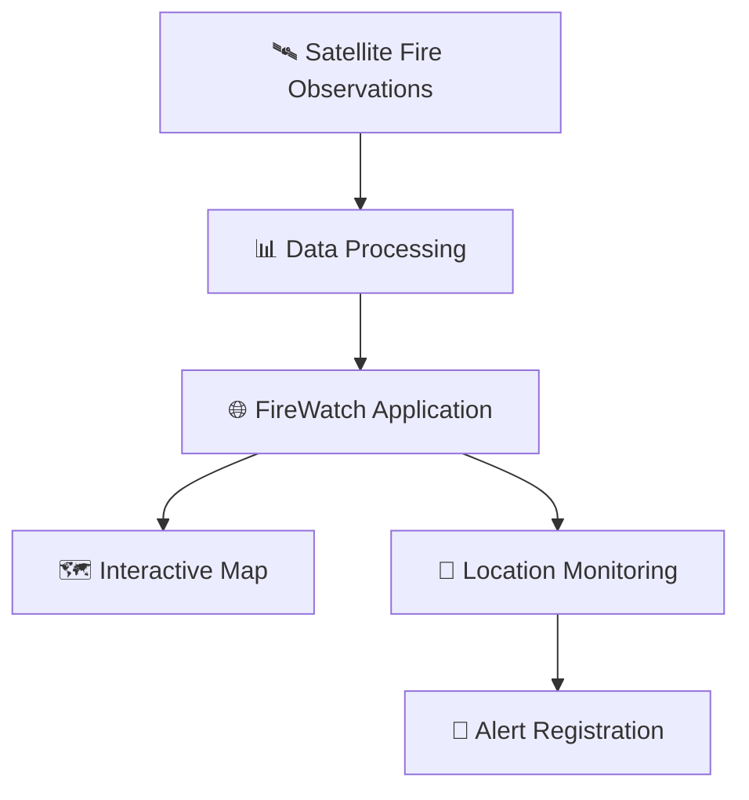

# 🔥 FIREWATCH
### Wildfire Intelligence, Powered by Satellite Data

**Turning satellite observations into accessible wildfire awareness.**

Built for the **NASA Space Apps Challenge** 🚀

**[Explore FireWatch](https://firewatch-frontend-5z5.pages.dev/)**

---

## 🌎 The Mission

Wildfires can spread rapidly, threatening communities, ecosystems, and infrastructure.

Satellite technology provides valuable observations of fire activity across the globe, but this information isn't always easy for everyday users to explore.

**FireWatch aims to bridge that gap.**

Created for the NASA Space Apps Challenge, FireWatch makes satellite-derived wildfire information more accessible through an interactive web application.

Our goal is simple:

> Make wildfire awareness more accessible, understandable, and actionable.

---

## ✨ Features

### 🛰️ Satellite-Based Fire Monitoring
Explore fire activity using satellite-derived observations and geospatial information.

### 🗺️ Interactive Wildfire Map
Visualize fire detections geographically through an interactive interface.

### 📍 Location-Based Monitoring
Choose an area of interest and explore wildfire activity relevant to that location.

### 📲 Wildfire Alert Registration
Register a monitoring location, alert radius, and phone number to request notifications.

*Alert delivery availability depends on the configured backend and notification service.*

---

## 📸 Application Preview

<!-- Add screenshots to an assets folder in your repository -->

<!-- Example:

-->

**🔥 [Try the Live Application](https://firewatch-frontend-5z5.pages.dev/)**

---

## ⚙️ How FireWatch Works

FireWatch transforms geospatial fire observations into information that users can explore through a web interface.

---

## 🛠️ Technology

Our application combines web development, geospatial data, and cloud-based services.

| Component | Technology |
|---|---|
| Hosting | Cloudflare Pages |
| Satellite observations | VIIRS |
| Frontend | To be confirmed |
| Backend | Cloudflare Pages Functions |
| Database | Cloudflare D1 |
| Mapping | To be confirmed |
| Notifications | To be confirmed |

---

## 🚀 Future Development

We hope to continue improving FireWatch by exploring:

- More timely wildfire data updates
- Improved alert delivery and monitoring
- Additional satellite datasets
- Better map filtering and visualization
- Expanded geographic coverage
- Improved mobile accessibility

---

## 👩‍💻 Meet the Team

Developed by **Maria & Roberta** for the NASA Space Apps Challenge.

This project brought together our interests in technology, real-world problem-solving, and building applications that can make a meaningful difference.

---

### 🌍 Stay Aware. Stay Informed.

**Explore wildfire activity with FireWatch.**

[🔥 Launch FireWatch](https://firewatch-frontend-5z5.pages.dev/)

*Made with curiosity, collaboration, and a passion for technology.*

